# HikerCircle SQLite ERD (1NF)

Schema version: **26**

This diagram shows the app-owned SQLite schema. Every column contains one
atomic SQLite value, satisfying first normal form (1NF). Columns ending in
`_json` intentionally store an atomic serialized document; their internal
shape is not normalized beyond 1NF. Most account and safety relationships are
logical so queued records survive sign-out and partial recovery. The compact
hazard dataset declares its internal hazard-to-trail relationship explicitly.

```mermaid
erDiagram
    USERS {
        TEXT phone_number PK
        TEXT created_at
        TEXT signed_in_at
        TEXT app_instance_id
        INTEGER is_admin
        TEXT username
        INTEGER requires_onboarding
        INTEGER onboarding_profile_complete
        TEXT photo_url
        BLOB photo_bytes
    }

    APP_DEVICE {
        INTEGER id PK
        TEXT app_instance_id
        TEXT created_at
    }

    EMERGENCY_CONTACTS {
        INTEGER id PK
        TEXT owner_phone_number
        TEXT contact_phone_number
        TEXT name
        TEXT relationship
        INTEGER position
        TEXT updated_at
    }

    ACTIVE_HIKE_SESSION {
        TEXT owner_phone_number PK
        TEXT session_id
        TEXT payload_json
        TEXT updated_at
    }

    PLANNED_HIKE_STATE {
        TEXT owner_phone_number PK
        TEXT upcoming_hike_id PK
        TEXT upcoming_payload_json
        TEXT completed_checklist_json
        INTEGER is_consumed
        TEXT updated_at
    }

    PENDING_HIKE_ENDS {
        TEXT owner_phone_number PK
        TEXT session_id PK
        TEXT active_hike_payload_json
        TEXT summary_payload_json
        TEXT ended_at
        TEXT created_at
        TEXT updated_at
        INTEGER retry_count
        TEXT last_error
    }

    LOCAL_LOCATION_POINTS {
        INTEGER id PK
        TEXT owner_phone_number
        TEXT session_id
        REAL latitude
        REAL longitude
        REAL altitude
        REAL accuracy
        INTEGER battery_level
        TEXT point_type
        TEXT recorded_at
        INTEGER is_synced
    }

    NETWORK_OBSERVATIONS {
        INTEGER id PK
        TEXT session_id
        REAL latitude
        REAL longitude
        REAL accuracy
        INTEGER network_available
        INTEGER api_request_success
        TEXT network_type
        TEXT recorded_at
        INTEGER is_synced
    }

    QUEUED_ALERTS {
        INTEGER id PK
        TEXT owner_phone_number
        TEXT session_id
        TEXT alert_type
        REAL trigger_latitude
        REAL trigger_longitude
        TEXT trigger_time
        REAL latest_latitude
        REAL latest_longitude
        TEXT latest_time
        INTEGER battery_level
        TEXT payload_json
        TEXT send_status
        INTEGER retry_count
        TEXT created_at
        TEXT last_error
        TEXT sent_at
    }

    PENDING_MESSAGES {
        TEXT local_id PK
        TEXT owner_phone_number
        TEXT chat_id
        TEXT sender_phone
        TEXT sender_name
        TEXT text
        TEXT created_at
        TEXT send_status
        INTEGER retry_count
        TEXT firestore_doc_id
        TEXT attachment_json
        TEXT updated_at
        TEXT last_error
    }

    CHAT_READ_RECEIPTS {
        TEXT owner_phone_number PK
        TEXT chat_id PK
        TEXT last_read_at
        INTEGER is_synced
    }

    CACHED_ENTITIES {
        TEXT owner_phone_number PK
        TEXT entity_type PK
        TEXT entity_id PK
        TEXT parent_id
        TEXT payload_json
        TEXT source_updated_at
        TEXT cached_at
        TEXT expires_at
    }

    SYNC_OUTBOX {
        TEXT operation_id PK
        TEXT owner_phone_number
        TEXT operation_type
        TEXT entity_type
        TEXT entity_id
        TEXT idempotency_key UK
        TEXT payload_json
        TEXT local_file_path
        TEXT status
        INTEGER attempt_count
        TEXT next_attempt_at
        TEXT last_error
        TEXT created_at
        TEXT updated_at
    }

    LOCAL_PREFERENCES {
        TEXT owner_phone_number PK
        TEXT preference_key PK
        TEXT value_json
        INTEGER is_dirty
        TEXT updated_at
    }

    ACHIEVEMENT_PROGRESS_CACHE {
        TEXT owner_phone_number PK
        TEXT content_hash
        TEXT payload_json
        TEXT cached_at
    }

    DOWNLOADED_MAPS {
        INTEGER id PK
        TEXT trail_id UK
        TEXT trail_name
        TEXT local_file_path
        INTEGER file_size
        TEXT downloaded_at
        TEXT last_weather_cached_at
        TEXT weather_expiry_time
    }

    OFFLINE_MAP_REGIONS {
        TEXT trail_id PK
        TEXT region_id UK
        TEXT style_uri
        TEXT bounds_json
        INTEGER min_zoom
        INTEGER max_zoom
        TEXT status
        INTEGER completed_resource_count
        INTEGER required_resource_count
        INTEGER completed_bytes
        TEXT downloaded_at
        TEXT updated_at
        TEXT last_error
    }

    HAZARD_FEATURES {
        INTEGER local_id PK
        TEXT hazard_id UK
        TEXT hazard_type
        TEXT title
        TEXT description
        REAL latitude
        REAL longitude
        TEXT severity
        TEXT confidence
        TEXT source_name
        TEXT source_url
        TEXT source_feature_id
        TEXT safety_guidance
        TEXT source_updated_at
        TEXT downloaded_at
        TEXT expires_at
    }

    TRAIL_HAZARD_MATCHES {
        TEXT trail_id PK
        TEXT hazard_id PK,FK
        TEXT relationship
        REAL distance_meters
        REAL route_progress
        TEXT computed_at
    }

    HAZARD_FEATURE_RTREE {
        INTEGER local_id PK
        REAL min_longitude
        REAL max_longitude
        REAL min_latitude
        REAL max_latitude
    }

    ROUTE_CACHE {
        TEXT trail_id PK
        TEXT checkpoints_hash PK
        TEXT encoded_polyline
        INTEGER distance_meters
        INTEGER duration_seconds
        REAL elevation_gain_meters
        TEXT source_label
        TEXT cached_at
    }

    DEVICE_NOTIFICATIONS {
        INTEGER id PK
        TEXT owner_phone_number
        TEXT message_id
        TEXT title
        TEXT body
        TEXT type
        TEXT deep_link
        TEXT data_json
        TEXT received_at
        TEXT opened_at
        TEXT source
        INTEGER is_starred
    }

    NEARBY_SOS_EVENTS {
        TEXT owner_phone_number PK
        TEXT event_key PK
        TEXT device_id
        INTEGER counter
        INTEGER rssi
        TEXT received_at
        TEXT updated_at
        REAL latitude
        REAL longitude
        REAL accuracy_meters
        TEXT location_captured_at
        REAL detector_latitude
        REAL detector_longitude
        REAL detector_accuracy_meters
        TEXT detector_captured_at
    }

    USERS ||--o{ EMERGENCY_CONTACTS : owns
    USERS ||--o| ACTIVE_HIKE_SESSION : runs
    USERS ||--o{ PLANNED_HIKE_STATE : plans
    USERS ||--o{ PENDING_HIKE_ENDS : queues
    USERS ||--o{ LOCAL_LOCATION_POINTS : records
    USERS ||--o{ QUEUED_ALERTS : raises
    USERS ||--o{ PENDING_MESSAGES : stores
    USERS ||--o{ CHAT_READ_RECEIPTS : tracks
    USERS ||--o{ CACHED_ENTITIES : caches
    USERS ||--o{ SYNC_OUTBOX : queues
    USERS ||--o{ LOCAL_PREFERENCES : configures
    USERS ||--o| ACHIEVEMENT_PROGRESS_CACHE : earns
    USERS ||--o{ DEVICE_NOTIFICATIONS : receives
    USERS ||--o{ NEARBY_SOS_EVENTS : detects
    ACTIVE_HIKE_SESSION ||--o{ LOCAL_LOCATION_POINTS : contains
    ACTIVE_HIKE_SESSION ||--o{ NETWORK_OBSERVATIONS : observes
    ACTIVE_HIKE_SESSION ||--o{ QUEUED_ALERTS : protects
    ACTIVE_HIKE_SESSION ||--o| PENDING_HIKE_ENDS : completes
    DOWNLOADED_MAPS ||--o| OFFLINE_MAP_REGIONS : identifies
    OFFLINE_MAP_REGIONS ||--o{ ROUTE_CACHE : complements
    HAZARD_FEATURES ||--o{ TRAIL_HAZARD_MATCHES : matched_to
    HAZARD_FEATURES ||--|| HAZARD_FEATURE_RTREE : spatially_indexes
```

`offline_map_regions.trail_id` is a legacy-compatible scope key; the
Malaysia-wide package uses `country:MY`. `cached_entities.entity_type`
currently supports trails, group chats,
community profiles, community posts, community comments, hike-history lists,
and hike-history details. `sync_outbox` is intentionally generic so additional
offline mutations can be added without another schema migration.

`hazard_features` stores compact Mapbox-derived river, stream, and cliff
points rather than full map tiles. `trail_hazard_matches` records why each
point matters to a route, while the SQLite R-tree accelerates geographic
lookups. Wildlife presence is deliberately not inferred from water features.
