# HikerCircle SQLite ERD

Schema version: **28**. Regenerated 16 October 2026 from current source; the Firestore refactor changes no local tables, columns, payloads or version.

All 25 app-owned tables and their columns are shown below. JSON columns are atomic SQLite values; this is a physical schema, not a claim that nested JSON is relationally normalized. Only declared foreign keys are drawn. Other account/session relationships are logical so durable queues can survive sign-out.

Editable diagram: [sqlite_erd.drawio](diagrams/sqlite_erd.drawio).

```mermaid
erDiagram
    BUTTON_DEBUG_SESSIONS {
        TEXT id PK
        TEXT owner_phone_number
        TEXT started_at
        TEXT ended_at
        TEXT status
        TEXT end_reason
        TEXT log_text
        TEXT file_path
    }
    BUTTON_DEBUG_ENTRIES {
        TEXT session_id PK
        INTEGER sequence PK
        TEXT timestamp
        TEXT direction
        TEXT operation
        TEXT device_id
        TEXT characteristic
        TEXT status
        BLOB payload
        TEXT interpretation
    }
    USERS {
        TEXT phone_number PK
        TEXT created_at
        TEXT signed_in_at
        TEXT app_instance_id
        INTEGER is_admin
        TEXT username
        INTEGER requires_onboarding
        INTEGER onboarding_profile_complete
        TEXT photo_url
        BLOB photo_bytes
    }
    LOCAL_LOCATION_POINTS {
        INTEGER id PK
        TEXT owner_phone_number
        TEXT session_id
        REAL latitude
        REAL longitude
        REAL altitude
        REAL accuracy
        INTEGER battery_level
        TEXT point_type
        TEXT recorded_at
        TEXT sample_key
        TEXT fix_captured_at
        INTEGER is_synced
    }
    QUEUED_ALERTS {
        INTEGER id PK
        TEXT owner_phone_number
        TEXT session_id
        TEXT alert_type
        REAL trigger_latitude
        REAL trigger_longitude
        TEXT trigger_time
        REAL latest_latitude
        REAL latest_longitude
        TEXT latest_time
        INTEGER battery_level
        TEXT payload_json
        TEXT send_status
        INTEGER retry_count
        TEXT created_at
        TEXT last_error
        TEXT sent_at
    }
    DOWNLOADED_MAPS {
        INTEGER id PK
        TEXT trail_id
        TEXT trail_name
        TEXT local_file_path
        INTEGER file_size
        TEXT downloaded_at
        TEXT last_weather_cached_at
        TEXT weather_expiry_time
    }
    NETWORK_OBSERVATIONS {
        INTEGER id PK
        TEXT session_id
        REAL latitude
        REAL longitude
        REAL accuracy
        INTEGER network_available
        INTEGER api_request_success
        TEXT network_type
        TEXT recorded_at
        INTEGER is_synced
    }
    APP_DEVICE {
        INTEGER id PK
        TEXT app_instance_id
        TEXT created_at
    }
    EMERGENCY_CONTACTS {
        INTEGER id PK
        TEXT owner_phone_number
        TEXT contact_phone_number
        TEXT name
        TEXT relationship
        INTEGER position
        TEXT updated_at
    }
    PENDING_MESSAGES {
        TEXT local_id PK
        TEXT chat_id
        TEXT sender_phone
        TEXT sender_name
        TEXT text
        TEXT created_at
        TEXT send_status
        INTEGER retry_count
        TEXT firestore_doc_id
        TEXT attachment_json
        TEXT owner_phone_number
        TEXT updated_at
        TEXT last_error
    }
    ACTIVE_HIKE_SESSION {
        TEXT owner_phone_number PK
        TEXT session_id
        TEXT payload_json
        TEXT updated_at
    }
    PENDING_HIKE_ENDS {
        TEXT owner_phone_number PK
        TEXT session_id PK
        TEXT active_hike_payload_json
        TEXT summary_payload_json
        TEXT ended_at
        TEXT created_at
        TEXT updated_at
        INTEGER retry_count
        TEXT last_error
    }
    PLANNED_HIKE_STATE {
        TEXT owner_phone_number PK
        TEXT upcoming_hike_id PK
        TEXT upcoming_payload_json
        TEXT completed_checklist_json
        INTEGER is_consumed
        TEXT updated_at
    }
    ACHIEVEMENT_PROGRESS_CACHE {
        TEXT owner_phone_number PK
        TEXT content_hash
        TEXT payload_json
        TEXT cached_at
    }
    CACHED_ENTITIES {
        TEXT owner_phone_number PK
        TEXT entity_type PK
        TEXT entity_id PK
        TEXT parent_id
        TEXT payload_json
        TEXT source_updated_at
        TEXT cached_at
        TEXT expires_at
    }
    SYNC_OUTBOX {
        TEXT operation_id PK
        TEXT owner_phone_number
        TEXT operation_type
        TEXT entity_type
        TEXT entity_id
        TEXT idempotency_key
        TEXT payload_json
        TEXT local_file_path
        TEXT status
        INTEGER attempt_count
        TEXT next_attempt_at
        TEXT last_error
        TEXT created_at
        TEXT updated_at
    }
    LOCAL_PREFERENCES {
        TEXT owner_phone_number PK
        TEXT preference_key PK
        TEXT value_json
        INTEGER is_dirty
        TEXT updated_at
    }
    OFFLINE_MAP_REGIONS {
        TEXT trail_id PK
        TEXT region_id
        TEXT style_uri
        TEXT bounds_json
        INTEGER min_zoom
        INTEGER max_zoom
        TEXT status
        INTEGER completed_resource_count
        INTEGER required_resource_count
        INTEGER completed_bytes
        TEXT downloaded_at
        TEXT updated_at
        TEXT last_error
    }
    HAZARD_FEATURES {
        INTEGER local_id PK
        TEXT hazard_id
        TEXT hazard_type
        TEXT title
        TEXT description
        REAL latitude
        REAL longitude
        TEXT severity
        TEXT confidence
        TEXT source_name
        TEXT source_url
        TEXT source_feature_id
        TEXT safety_guidance
        TEXT source_updated_at
        TEXT downloaded_at
        TEXT expires_at
    }
    TRAIL_HAZARD_MATCHES {
        TEXT trail_id PK
        TEXT hazard_id PK
        TEXT relationship
        REAL distance_meters
        REAL route_progress
        TEXT computed_at
    }
    HAZARD_FEATURE_RTREE {
        INTEGER local_id PK
        REAL min_longitude
        REAL max_longitude
        REAL min_latitude
        REAL max_latitude
    }
    CHAT_READ_RECEIPTS {
        TEXT chat_id PK
        TEXT owner_phone_number PK
        TEXT last_read_at
        INTEGER is_synced
    }
    DEVICE_NOTIFICATIONS {
        INTEGER id PK
        TEXT owner_phone_number
        TEXT message_id
        TEXT title
        TEXT body
        TEXT type
        TEXT deep_link
        TEXT data_json
        TEXT received_at
        TEXT opened_at
        TEXT source
        INTEGER is_starred
    }
    NEARBY_SOS_EVENTS {
        TEXT owner_phone_number PK
        TEXT event_key PK
        TEXT device_id
        INTEGER counter
        INTEGER rssi
        TEXT received_at
        TEXT updated_at
        REAL latitude
        REAL longitude
        REAL accuracy_meters
        TEXT location_captured_at
        REAL detector_latitude
        REAL detector_longitude
        REAL detector_accuracy_meters
        TEXT detector_captured_at
    }
    ROUTE_CACHE {
        TEXT trail_id PK
        TEXT checkpoints_hash PK
        TEXT encoded_polyline
        INTEGER distance_meters
        INTEGER duration_seconds
        REAL elevation_gain_meters
        TEXT source_label
        TEXT cached_at
    }
    BUTTON_DEBUG_SESSIONS ||--o{ BUTTON_DEBUG_ENTRIES : "session_id references id"
    HAZARD_FEATURES ||--o{ TRAIL_HAZARD_MATCHES : "hazard_id references hazard_id"
    HAZARD_FEATURES ||--o| HAZARD_FEATURE_RTREE : "local_id references local_id"
```

`hazard_feature_rtree` is the existing portable bounds table with longitude/latitude indexes, rather than an optional SQLite R-tree virtual table. The map-region scope key and all offline payload formats remain unchanged.
